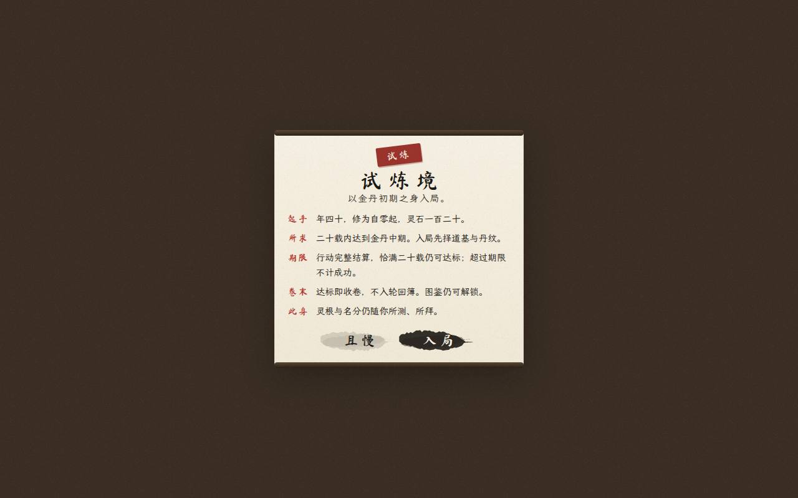
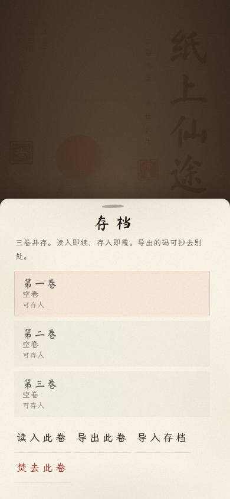
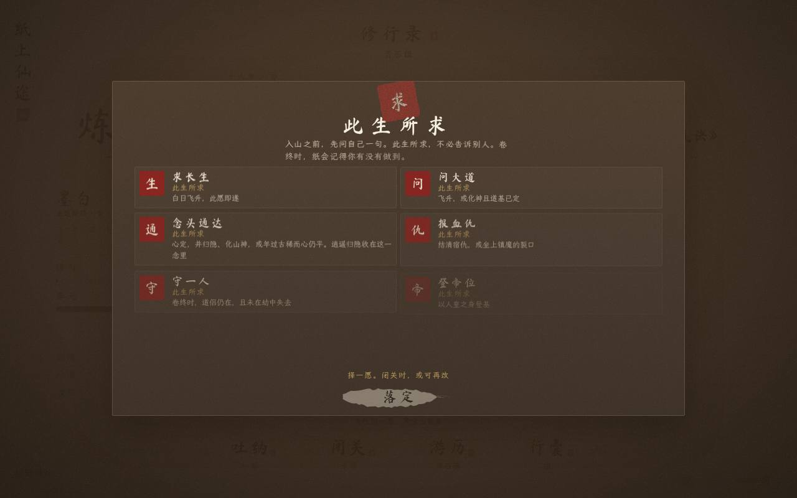
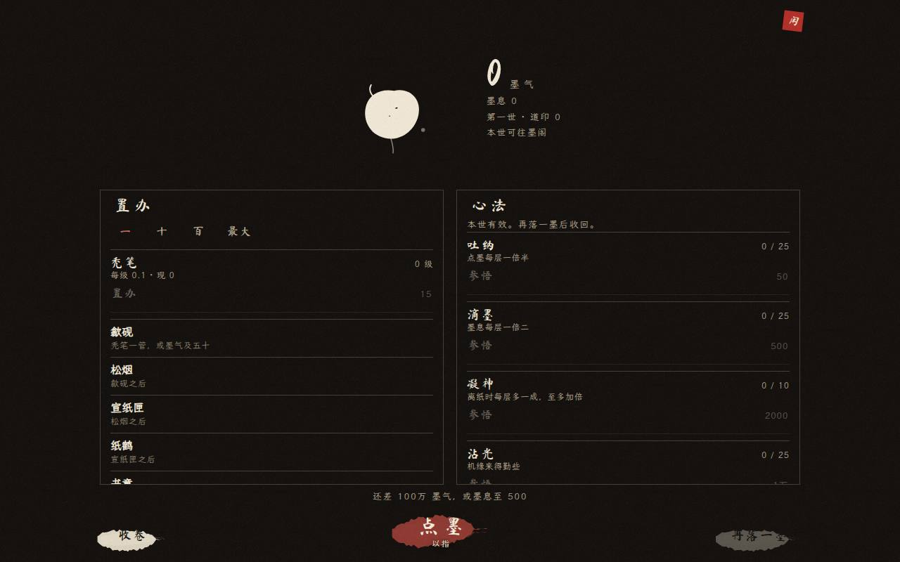
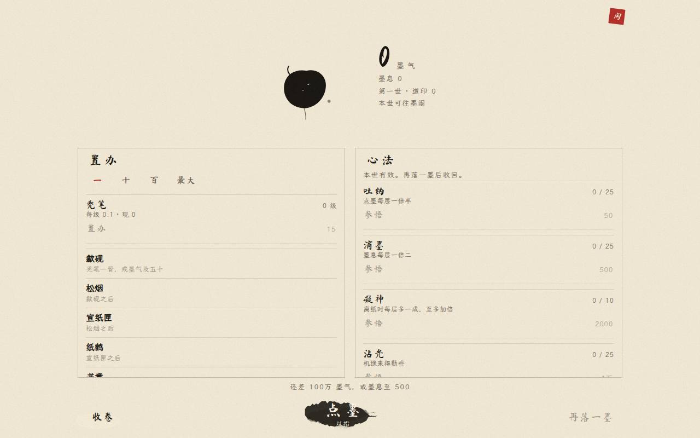
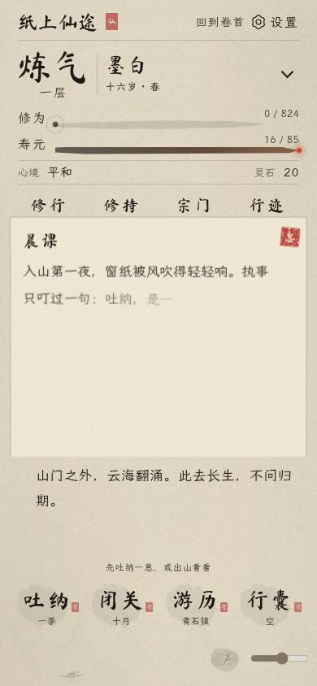

# v105 界面审计

2026-10-29。只读。对照 `main` `048b56b`（墨童闲录，缓存 `moxian-v105`）。没有改玩法，也没有改样式。

桌面无头 Chromium 量过 390×844、390×700、768×1024、1024×768、1280×800。开卷动效走简档，卷首取的是落定后的画面。真机 Safari 未测。

基线：主界面与卷首同一张静纸、淡墨边；奇遇是同纸揭笺（淡罩、淡边、角上一印）。v89 的开卷书写和洇舟保持原样。闲录算进这一轮。

## 上一轮还在不在

v102 记过四条。v103–v105 之后的现状：

| 当时 | 现在 |
| --- | --- |
| 晨课、奇遇还是厚木轴 | 晨课走奇遇，奇遇是 `#modal.tip-in`。轴宽被收成 0。390 与 1280 上都是同纸一笺 |
| 地图两侧厚木轴 | `.map-roller` 是 1px 淡墨。厚木轴不在 |
| 掌上音量条和「静」被裁出画面 | 390×844 与 390×700 上，设、声、音量条的盒子都在视口内。1280 音量条也在 |
| 768 卷首菜单压山，日缘读不清 | 中宽有一层淡纸托着四枚，日缘能读。孤松还在右侧 |
| 官网「立刻试玩」被裁 | 390 / 1024 / 1280 顶栏按钮的布局盒都在页内。1280 右缘量到 1232 |

## P0

没有。正传存档键、`SAVE_V`、闲录键是分开的。页面没有横向溢出。

## P1 和静墨、揭笺不在一张纸上

**试炼说明还架着木轴。** `js/game.js` 的试炼简介和 `inkConfirm` 都生成 `.ask-card`。`css/style.css` 1582 行用 9px 的 `#5a4632 → #2a2018` 渐变画上下两根轴。v51 又把 `.ask-shade` 压成实色 `#3a2e24`。卷首一点「试炼」就是这块深褐底上的木轴卡片。v103 收掉的是奇遇、地图和主卷的轴，这张问询纸没动。

**行囊、存档、图鉴仍是一块压暗的浮笺。** `.sheet-shade` 在 v79（约 3555 行）是大约九成的暖褐罩。窄屏 `.sheet-panel`（509 行）上缘是 14px 圆角，从底下卷上来。宽屏改成居中卡片，阴影 `0 24px 64px`。揭笺是直角淡边、底下的字还在；存档一开，卷首整幅被压暗。

**出身、拜山、道基、此生所求仍是深色仪式。** `.path-cer-shade` 在 v51 是实色深褐。所求在 v79 换成稍暖的径向罩，面板仍是 `#3f3329` 上的浅字。入山后第一张要选的纸，和刚揭开的奇遇不是一种东西。

**夜墨里墨童变成一块白。** `css/idle.css` 里墨童 `color: var(--ink)`，纸孔 `fill: var(--paper)`。夜墨把 `--ink` 换成浅色、`--paper` 换成近黑，墨滴跟着反成白团。设计是「一滴不规则的墨」。白昼是黑的，夜墨不是。

**闲录是铺上一张新纸，不是在卷首上揭一笺。** `.idle` 用实色 `var(--paper)` 盖住远山、舟和松（`z-index: 30`，景在它下面）。再落一墨的 `.idle-slip` 倒是按揭笺写的：淡罩、淡边、角印。主层两边各一个直角线框（`.idle-col` 的 1px 边），更像表，不像卷首那一层纸。

## P2 适配和收尾

**矮手机上，闲录的笔触挨着声钮。** 390×844：闲录按钮底在 768，声钮顶在 786，笔触再向下伸出约 14px，还留得住。390×700：按钮底 636、高 42，声钮顶 642，笔触和声钮叠了大约 8px。声、设、音量条的盒子仍在 390 宽以内，叠住的是笔触下缘。闲录这枚是 v105 新加的，v103 的底边距按原来的四枚算。

**700 到 999 宽不常驻音量条。** 音量条默认 `display: none`。常驻只写在三处：宽 ≤520、竖屏且宽 ≤699、宽 ≥1000。768 的无头桌面测到滑条是 `display: none`。设和声还在右下，没有出画。触屏平板在这一档点不到滑条。

**闲录窄屏点按偏小，键盘进不去。** 高 ≤740 且宽 ≤719 时，`#btn-idle` 的 `min-height` 收到 36px。打开后焦点留在卷首那枚按钮上，而 `#app` 已被标成 `aria-hidden`。文档级按键监听对焦点不在闲录里的键一律 `preventDefault`，Tab 走不进「收卷」。Esc 能关。

**桌面闲录的下一行被框边切住。** 1280 左栏「书童」只露出半行，滚动条要悬停才出现。768 宽已经超过 719，走的是双栏，最后一行「纸外虚空」贴着底边。

**地图和秘境整页换纸。** 地图两侧只剩 1px。秘境 `.mj` 铺满视口，上下还有一圈 `--tint` 色晕。斗法、破境、拍卖、终卷仍走 v51 的实色罩，出现次数少，和试炼、存档、所求分开记。

**官网顶栏的墨形右缘收得很急。** 390、1024、1280 的「立刻试玩」布局盒都在页内（1280 右缘 1232 / 1280）。墨块本身靠右，看起来像被切过一刀。正文「修行录」没有从字中间断开。页面横向没有溢出，竖向变长是长页本身。

## P3 可以以后收

- `#modal` 里左右 `.hroller` 还在 `index.html`，揭笺把它们宽高收成 0。节点可以拿掉，现在看不见。
- `body.idle-on` 有类名，没有对应样式。
- `.page-aside` 在宽屏用了 `writing-mode: vertical-rl`，主卷规则又把它 `visibility: hidden`。1680 以上的栏外竖字实际不出现。地图 `.tag-flag` 也用了 `writing-mode`，和「竖排逐字堆、不用 writing-mode」不一致，旧 WebKit 有裁字的记录。
- 秘境色晕用了 `color-mix()`，前一条声明是不带 `color-mix` 的退路。
- `js/idle.js` 的 `fmt` 在极大数字上写成 `×10^`。这一路平常走不到；`^` 也不在子集字体的常例里。
- `css/style.css` 里遮罩写了三代：v51 实色、v79 暖罩、v104 只把 `.tip-in` 盖回去。改下一张笺时要看谁的 `!important` 在后面。

## 存档、闲录、缓存

核对过，没有要改的键。

- 闲录只 `localStorage.setItem('moxian-idle-v1', …)`。不读不写 `moxian.v1`、`moxian.slots`、`moxian.look`、`moxian.notice`，也不动 `MX1` 和 `SAVE_V`。
- 坏 JSON 会回到一份空进度。字段按已知建筑和心法抄，多出来的键丢掉。
- `index.html` 的 `EXPECT` 与 `sw.js` 的 `CACHE` 都是 `moxian-v105`。`css/idle.css` 在预缓存里。`js/idle.js` 和别的脚本一样，第一次取到再进当前缓存，不单独升号。

## 图

八张都是无头 Chromium、简动效、开卷落定之后。

- `menu-390.jpg` 掌上卷首。设、声、音量在画内，闲录在四枚之下。
- `menu-768.jpg` 中宽卷首。日缘落在淡纸上，右侧还有松。
- `event-390.jpg` 晨课揭笺。拍摄时墨还在往下走，所以正文没写完；笺本身是淡边、角印，底下的录还看得见。
- `trial-1280.jpg` 试炼说明上的木轴。
- `sheet-390.jpg` 存档底栏，圆角，底被压暗。
- `goal-1280.jpg` 此生所求的深色仪式。
- `idle-1280.jpg` 闲录双栏线框。
- `idle-1280-night.jpg` 夜墨里墨童反白。
