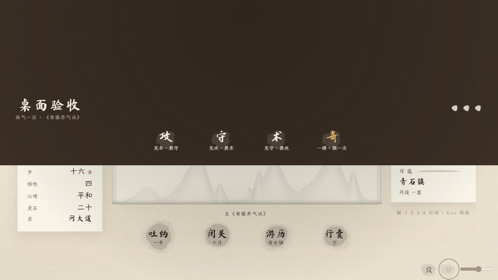
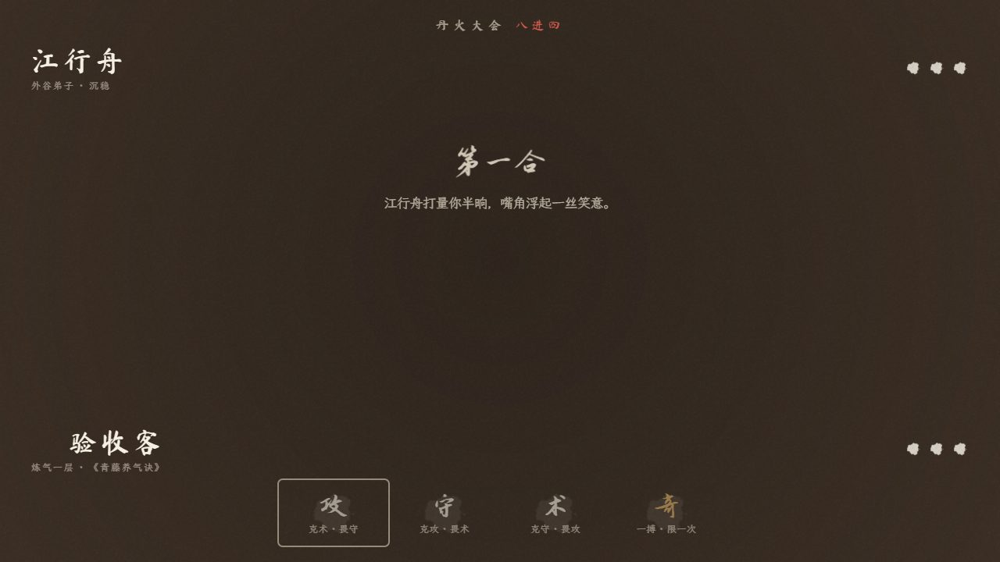
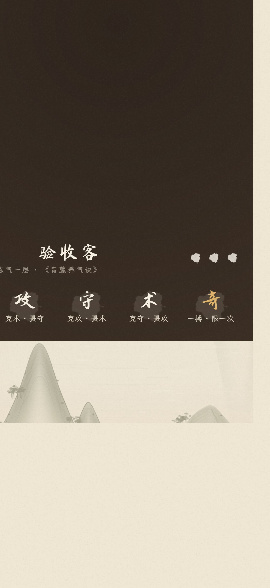
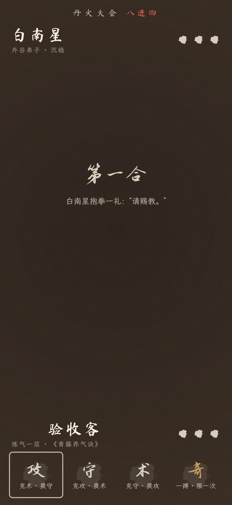
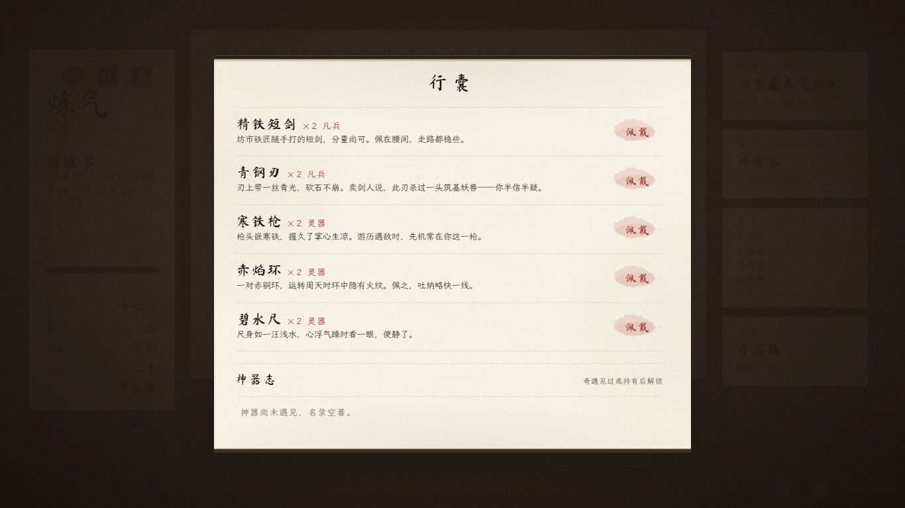
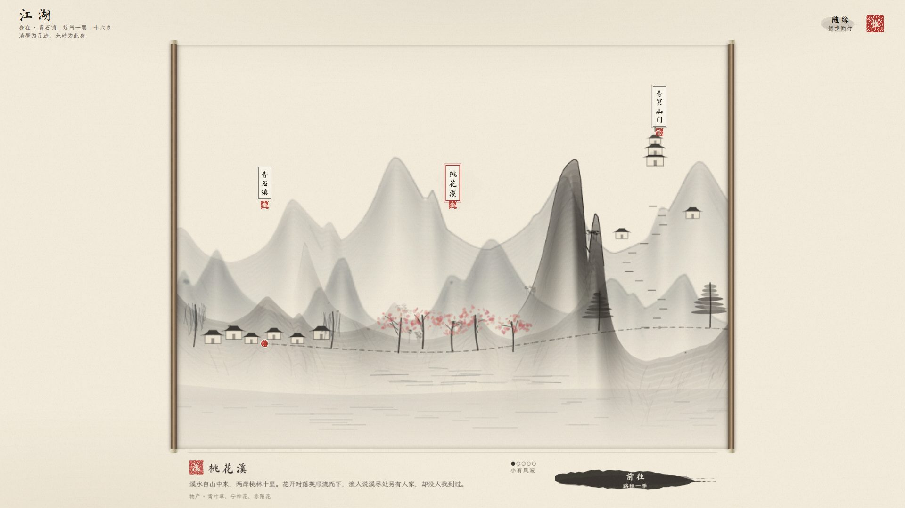
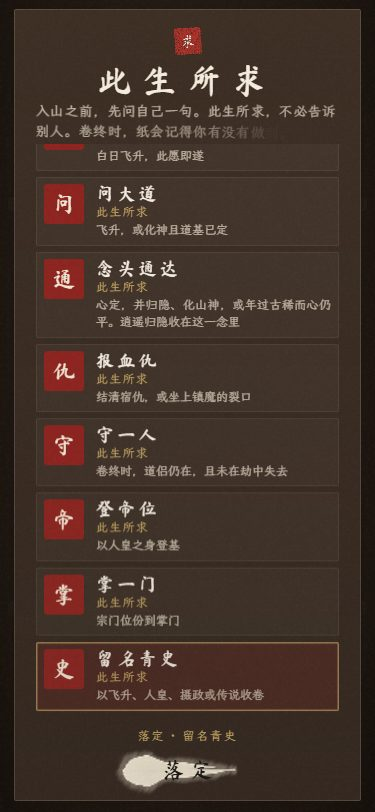

# v92 桌面体验排查与布局修复

日期：2026-10-26（Asia/Shanghai）。基线：main `1ebec3f2570ffe38730b5da3c9898915fa8ddd9d`（撤回 v91 后的 v90），tree `27040898d2cd4a44e37d23ff44a247fef4361e3e`。源码归档解压后建立本地检查点，Git tree 与上游相同。旧工作目录的未提交改动保留，未拉取覆盖或重置。

## 修复一：斗法装饰层撑出隐藏滚动区

原版 1280×720 中，`#duel.clientHeight = 720`、`scrollHeight = 1443`。原因是 `150vmax` 且旋转的扩散墨层，超出斗法容器。`overflow:hidden` 隐藏滚动条，但仍允许聚焦/程序滚动。

复现：进入丹火大会，等招式可选，对攻按钮调用标准 `scrollIntoView({block:'center'})`。`#duel.scrollTop` 变为 297；对手名字 top=-241，招式提示 top≈-53，遮罩底部降到425。滚轮上滚不能恢复。再战可能继承更大的偏移。这与 [#47 的 v78 现场](https://github.com/loser-gif/xiuxian-ink/issues/47#issuecomment-6380078246) 一致。

边界：本轮普通鼠标点击首战、再战与方向键切换，没有单独触发这个偏移。因此本报告不把它写成“鼠标必现”或“战斗逻辑卡死”。居中滚动是对旧自动化/焦点滚动现场的定向复现。

修复：将遮罩和扩散墨层收进一个绝对定位、单独裁切的 `.duel-backdrop`。保留墨层大小、笔触、透明度和动画；正常内容照旧。修复后该尺寸 `clientHeight = scrollHeight = 720`，同样的居中滚动不会移动对手、提示或遮罩。





## 修复二：窄屏抽屉透视误作用于 body

在窄于700px（或高度小于520px）的规则中，`.sheet{perspective:1400px}` 同时匹配抽屉和用于纸面模式的 `body.sheet`。透视使 body 成为固定定位子元素的包含块；滚动愿望选项后，body 可以保留隐藏滚动偏移，整页固定层一起偏离视口。

440×956 的定向复现：开局→打开并收起行囊→游历桃花溪→打开此生所求→点最后一项并落定→演武。观察到 body.scrollTop=402，#app 与 #duel.top=-402，body.perspective=1400px。临时取消 body 上的透视后，三者恢复到0。

修复只把该规则限定为 `#sheet{perspective:1400px}`；抽屉的卷起动画保留，body 不再参与透视。





## 验证范围与方法

- Windows / Edge 156.0.4314.42，独立无头浏览器上下文，不访问玩家原存档。
- 桌面：1280×720、1366×768、1920×1080；另按仓库规则补1280×800、1440×900。
- 窄屏：440×956（DPR 3）、390×844、375×812。各尺寸均检查昼、夜。窄屏为桌面浏览器模拟尺寸，不冒充 iPhone Safari 真机验收。
- 普通新局单独走过开卷、测灵根、出身、拜山、此生所求、晨课与行囊。晨课“这些我已知”结果会自动收卷，旧反馈未重现。
- 浏览器回归使用隔离测试角色；长日志与满行囊人为填充，用滚轮验证首尾可达；通过实际按钮打开行囊、游历地图、前往桃花溪、滚动愿望选项并确认。
- 演武通过现有调试入口进入；三个主要桌面尺寸的日间测试完成整场比赛并回到主界面，核查记录。为覆盖后续场次，测试只读观察真实 `Core.duelTell` 的下一招并选择克制招式，未改战斗结算或随机数。这是白盒交互测试，不是自然完整人生试玩或战斗平衡结论。
- 原版控制组执行同一套回归：8/13通过，5项斗法几何失败（见 [baseline-checks.json](baseline-checks.json)）。修复后189/189通过，浏览器脚本异常0；结果见 [checks.json](checks.json)。
- `node --check`：game、notices、regress_desktop；CSS括号2836对；`git diff --check`通过。
- `playtest.js`、`regress_xiaobi.js`、`regress_soft.js`、`regress_auction.js`、`regress_time_feedback.js`通过；时间反馈39组。
- 事件审计116,644次结算，0违例；字体三套缺字0、子集重叠0。
- `node tools/sim.js 600 balanced`：三灵根全体中位82.2分钟，在AGENTS规定的80–90分钟范围；模拟敌我结算54,585次，0以强受伤违例。没有修改数值公式。
- SAVE_V仍为16，MX1与存档键不变。发布使用v92，避免复用已撤回的v91缓存身份。

### 重跑浏览器回归

使用已有 Playwright 与本机浏览器，不给静态游戏增加依赖。

```powershell
$env:PLAYWRIGHT_MODULE = '已有的 Playwright 模块目录'
$env:BROWSER_EXE = '本机 Edge 或 Chromium 可执行文件路径'
node tools/regress_desktop.js 'D:\Codex\desktop-checks'
```

`QUICK=1`仅跑1280×720日间，可用于缺陷控制组；完整验收不设置该变量。输出包括逐项几何、脚本异常与JPEG截图。

## 历史反馈分流

| 来源 / 事项 | 本轮判断与证据 | 处理 |
| --- | --- | --- |
| #34 桌面地图塌缩 | 当前宽度正常，真实地图按钮可前往桃花溪 | 已修项，未重复开发 |
| #34 此生所求底部确认不可达 | 最后一项可选、确认按钮在视口内，滚动后可收起 | 保留；额外定位并修正窄屏body透视问题 |
| #34 晨课收卷 | 普通新局选择“这些我已知”后自动收起 | 未重现旧缺陷 |
| #47 斗法对手/提示被滚出屏幕 | 原版控制组和截图复现，鼠标独立复现边界见上 | 本轮修复 |
| #47 半决疑似残留上一战文字 | DOM保留文字，但正常截图中旧招式与胜印已隐藏 | 未发现可见残留，不清改战斗逻辑 |
| #47 寄拍最后一件阻断/存档 | 现有寄拍结算、中断重载、重复结算回归通过 | 已有修复；本轮未重新走整场真人拍卖 |
| #47 行旅与转修时间 | 现有39组回归通过，公式未动 | 已修项 |
| #47 平生重复、进货收起、上架件数、休市、延迟晨课、施药禁用原因 | v80实现及soft回归通过 | 已修项，不重新改文案 |
| #34/#47 功法、人物、红尘、阵图与法相内容建议 | 已有v69–v73实现；本轮只核对版本/记录，不宣称所有分支实玩完成 | 独立内容验收与后续设计 |
| 经营利润口径、售价/件数限制、季节与“一夜”叙事、人物回访 | 属规则解释/产品体验，未据单局样本确认数值缺陷 | 保留待办，不擅自调平衡或批量改正文 |
| 世界观、反复模拟与开局重做、画卷新布局 | 尚需用户定稿 | 本轮不实施概念图 |

两条issue仍包含产品建议，因此不整体关闭。本轮报告也不宣称全游戏、所有结局、Safari/旧内核或Steam桌面包已验收。

### 补充截图






