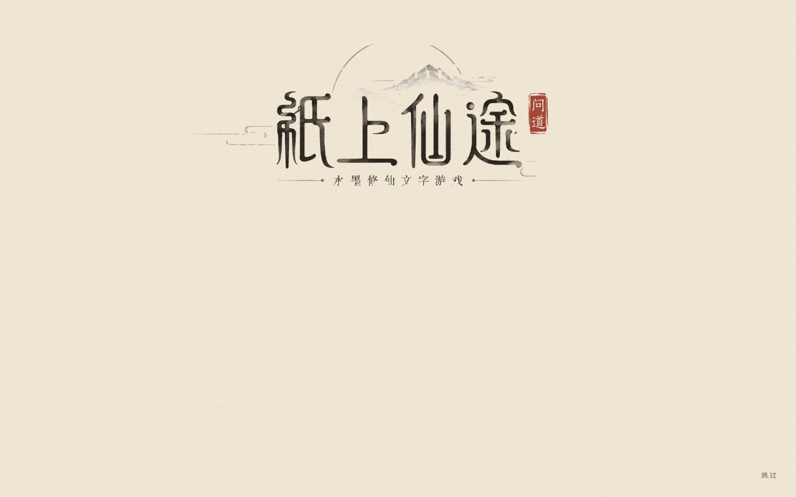
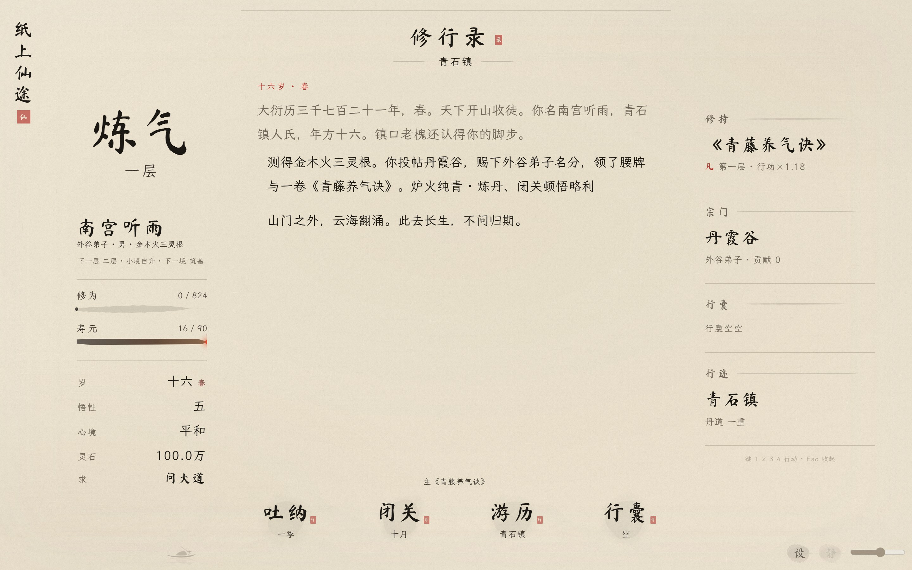

# v98 从容开卷

2026-10-27。依据用户本轮反馈，以 v95 原版题额写画、墨落成舟、山河展开为基础打磨。撤下 v96 的分层淡入方案；不以缩短时长为目标。

先查阅 GitHub 的 [Vivus](https://github.com/maxwellito/vivus) 与 [OverlayScrollbars](https://github.com/KingSora/OverlayScrollbars)。本项目已有题额分层素材、画布写画与原生滚动容器，复用这些即可完成要求，不增加第三方依赖。

## 开场

恢复原题额素材和笔画显露。写画约 4.8 秒，留 0.65 秒落定；墨滴下落并洇成舟约 2.3 秒，山河展开约 4.2 秒，最后与菜单落笔交叠，总计约 14 秒（不含资源载入）。柔化原来近乎硬切的圆形遮罩边缘，水纹收在落墨附近；临时小舟与菜单小舟交叉淡化，镜头从原位继续缓动。

点击或 Enter/Space/Escape 可跳过；保留长按至松手的防误触保护。减少动态/简动效直接落定，不强迫看完整演出；正常回访不再自动压缩成 0.9 秒。素材失败、切后台、改变减少动态设置时可正常回到可操作菜单。

## 手机适配

竖屏从原题额分层素材重排四字、淡景与朱印，保持原笔迹比例；根据屏幕高度留出落墨距离。旋转时重排画布并重新测量小舟位置。菜单标题、两枚主笔、四枚小钮和声音区分开，有旧存档时也不相撞。矮屏同步调整山、日与湖面的位置。

主卷收紧顶部人物、境界与数值区，把空间归还正文；人物详情可展开，四个页签及底部行动保持可操作。手机音量按钮保留 44px 点按高度。

[440px 菜单](menu-mobile.jpg) · [320px 菜单](menu-small.jpg) · [手机正文](main-mobile.jpg) · [矮屏正文](main-small.jpg) · [横屏](menu-landscape.jpg)

## 两处红框

右侧笺条默认透明，实际滚动或键盘聚焦时显现，停下后隐去。仍使用原生滚动，不移除内容，不改变滚动时的文字宽度。

活墨收锋原先用急剧增加的距离值截住湿墨，形成直立断口。改为连续收尖、末端淡化和稍长的飞白；静态 SVG 同步收拢末点，并留出画布边距。

## 验收

- [开场检查](opening-checks.json)：34/34。原图绘制、完整时序、成舟揭幕、自然交接、点击/按键/长按跳过、焦点恢复、续卷、减少动态、受限存储与手机昼夜。
- [移动与边界检查](layout-checks.json)：36/36。320、360、375、390、440px 及手机横屏；有存档菜单、正文空间、安全区、大字号、展开详情、动画中旋转、侧条显隐、无 WebGL 和图片失败降级。
- [主界面回归](wallpaper-checks.json)：35/35。同纸底、动效暂停恢复、主菜单往返、五尺寸昼夜和 DPR3 画布预算。
- playtest、regress_logs、regress_soft、JS 语法、版本一致性和字体审计通过，缺字 0。
- [核心文件比对](protected-files.json)：存档/核心玩法相关文件与 v97 相同，SAVE_V 仍为 16。

测试为 Windows Edge/Chromium，手机为触控/视口模拟，未进行 iOS Safari 真机验收。隐藏事件使用模拟 visibilitychange。录屏位于工作区 outputs/graceful-voyage-v98，未打入游戏资源。线上发布状态另核对 Pages 与实际网址。
