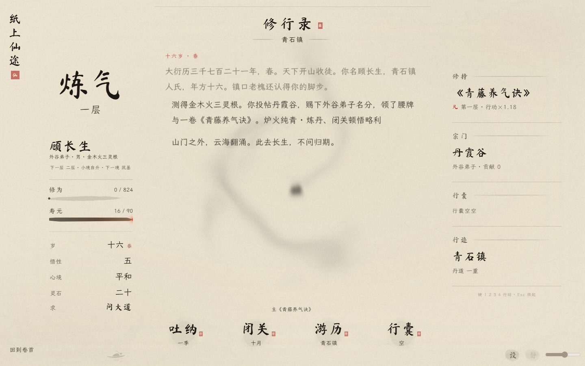
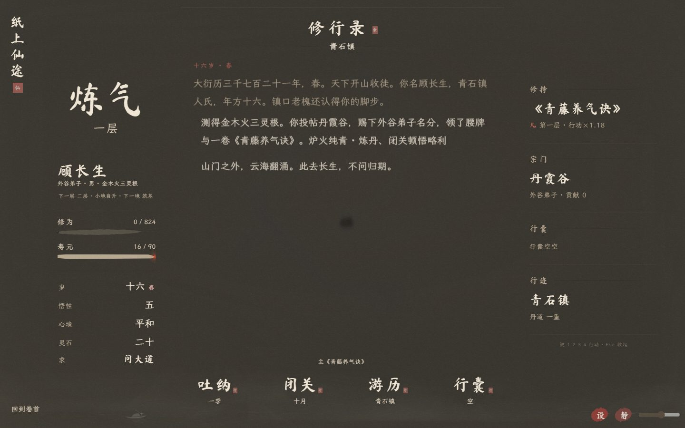
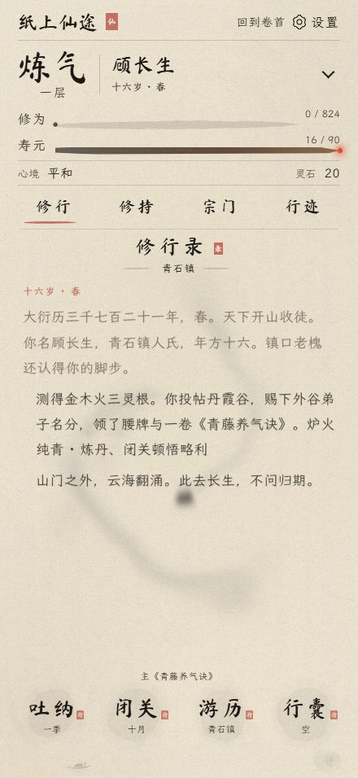
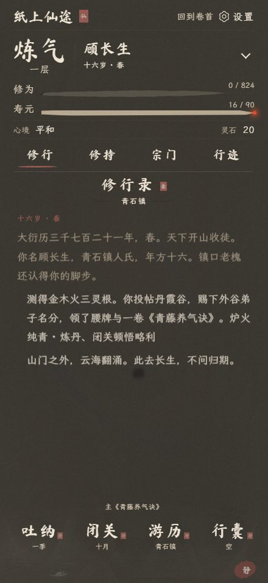
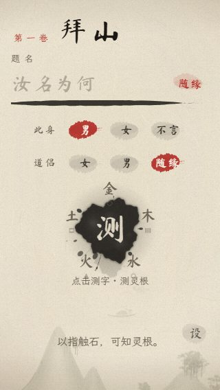
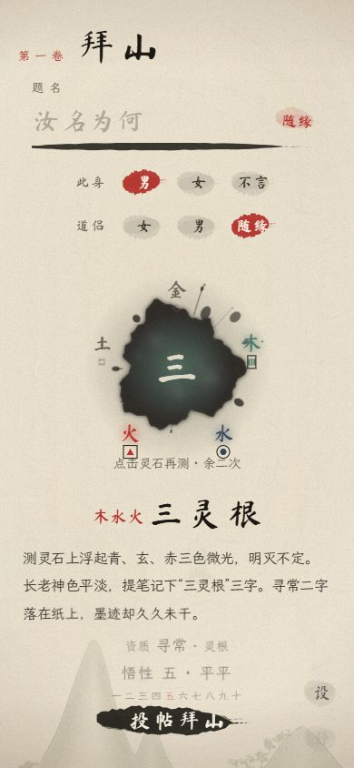

# v101 · 触石回卷

2026-10-27。基于 main 的 fd6f571，保留 #85 新增官网。

- 吐纳的螺旋墨气在抵达画布边缘前按椭圆柔和散尽，避免日志底部和两侧的矩形裁边；结算时机与修为公式不变。
- 常驻“回到卷首”：桌面左下，手机顶栏；复用保存和回卷流程，动作结算中不切走。
- 原生按钮直接覆盖中央灵石，移除底部重复入口；测完在原处再测，首次加两次重测，禁用期间连点不扣次数。支持点击、Enter、空格，提示与读屏名称随状态更新。

## 验证

`tools/regress_interactions.js`：103/103。覆盖 320×568、440×956 昼夜、844×390、1440×900 昼夜；检测 0.25/0.6/1.25 秒特效帧的四边 alpha 为 0，中心仍有墨；验证一次结算、忙时回卷保护、保存后续卷的姓名/年月/修为/日志、两次重测及无页面异常。结果见 [checks.json](checks.json)。

补充实测简动效和无 WebGL 时吐纳正常结算。字体审计无缺字，脚本语法、regress_soft 和 diff 检查通过。使用 Windows Edge 桌面及手机视口模拟，未进行 iPhone Safari 真机测试。SAVE_V 仍为 16，开场与转场动画未改。

按钮参考检索：[W3C ARIA Practices](https://github.com/w3c/aria-practices)，采用浏览器原生 button，无新增依赖。

## 画面

