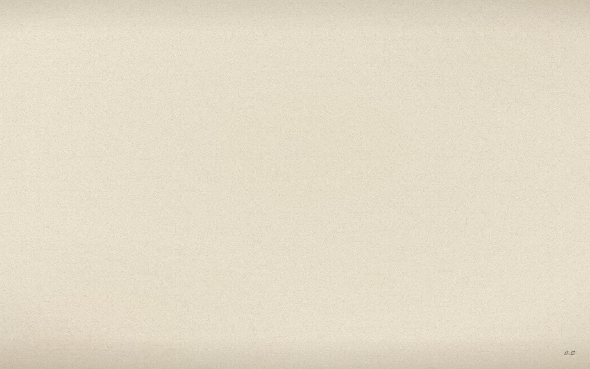
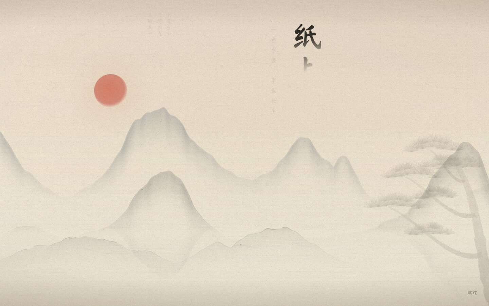
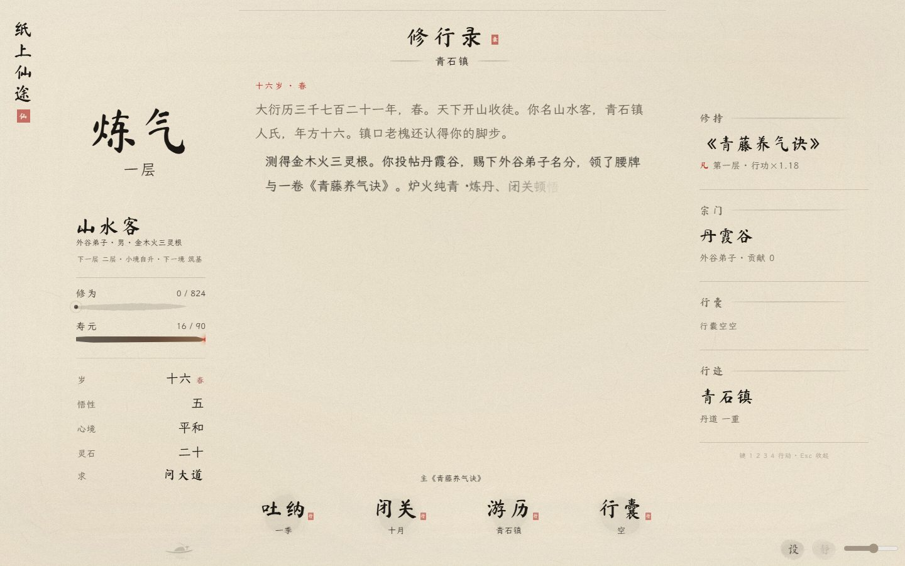

# v96 空纸生山河

2026-10-26。按本轮确认的开场方向，把卷首直接作为动画终点。先检索 GitHub 的 [Vivus](https://github.com/maxwellito/vivus)；它适合 SVG 路径描画，但现有字体与山水是字形遮罩及 canvas，因此复用已有素材和 CSS 动画，不引入依赖。

## 体验

远山逐层显墨，竖题与题诗穿插出现，湖上墨点淡成原位小舟，问道印轻落，菜单显现。取消独立题额影片、落滴及圆形揭幕，不再换一张背景。保留既有卷首构图与菜单文字，不新增山水素材。

首次动画约 5.6 秒，回访约 0.9 秒，简动效或系统减少动态约 0.24 秒；均不含首次资源载入时间。点任意处或按 Enter、Space、Escape 可跳过，右下有明确的跳过按钮。跳过不会顺手点进游戏；键盘/辅助技术操作后焦点返回菜单。切到后台或启用系统减少动态时直接落定。

开卷与续卷以文字淡出、内页显现衔接，共用同一个纸面 canvas，不再盖一层转场墨幕。SAVE_V 保持 16；仅新增独立的 moxian.openingSeen 展示偏好，不写入角色存档。

## 实际截图

[手机菜单](menu-mobile.jpg) · [手机夜墨](menu-mobile-night.jpg) · [手机内页](main-mobile.jpg)

## 验收与边界

- [开场浏览器检查](opening-checks.json)：28/28，通过阶段顺序、首次/回访计时、鼠标及三种按键跳过、辅助技术 click、焦点恢复、后续点击、读档续卷、存储受限、低动态、隐藏事件和手机旋转尺寸变化。
- [主界面回归](wallpaper-checks.json)：35/35，通过同纸底、雾舟动静切换、菜单往返、手机入口及 5 个尺寸的昼夜布局、DPR3 画布预算。
- JS 语法、diff 空白检查、regress_soft 缓存一致性检查和字体审计通过（缺字 0）。
- [受保护文件](protected-files.json) 与 v95 相同；此次不调整玩法数值。

环境：Windows Edge/Chromium。手机为浏览器视口模拟，没有 iOS Safari 真机；隐藏标签通过模拟 visibilitychange 检查处理逻辑。录屏保存在工作区 outputs/paper-awakening-v96，未将视频打入游戏资源。线上部署结果另行核实。

## v97 跳过输入补验

长按 Enter 跳过后，重复按键曾在松手前触发开卷。现保留输入保护至松手，并吸收尾随点击；普通点击、长按鼠标、重复 Enter 及松手后下一次操作均已覆盖。[32/32 开场检查](opening-checks-v97.json) 全通过；regress_soft、语法与字体审计再次通过。视觉和主界面样式沿用 v96，未重跑未变的主界面布局矩阵。
