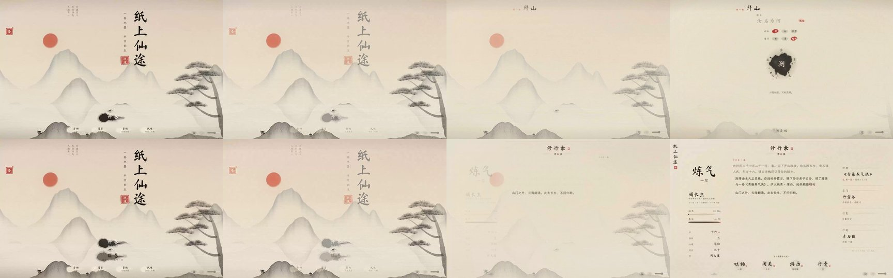
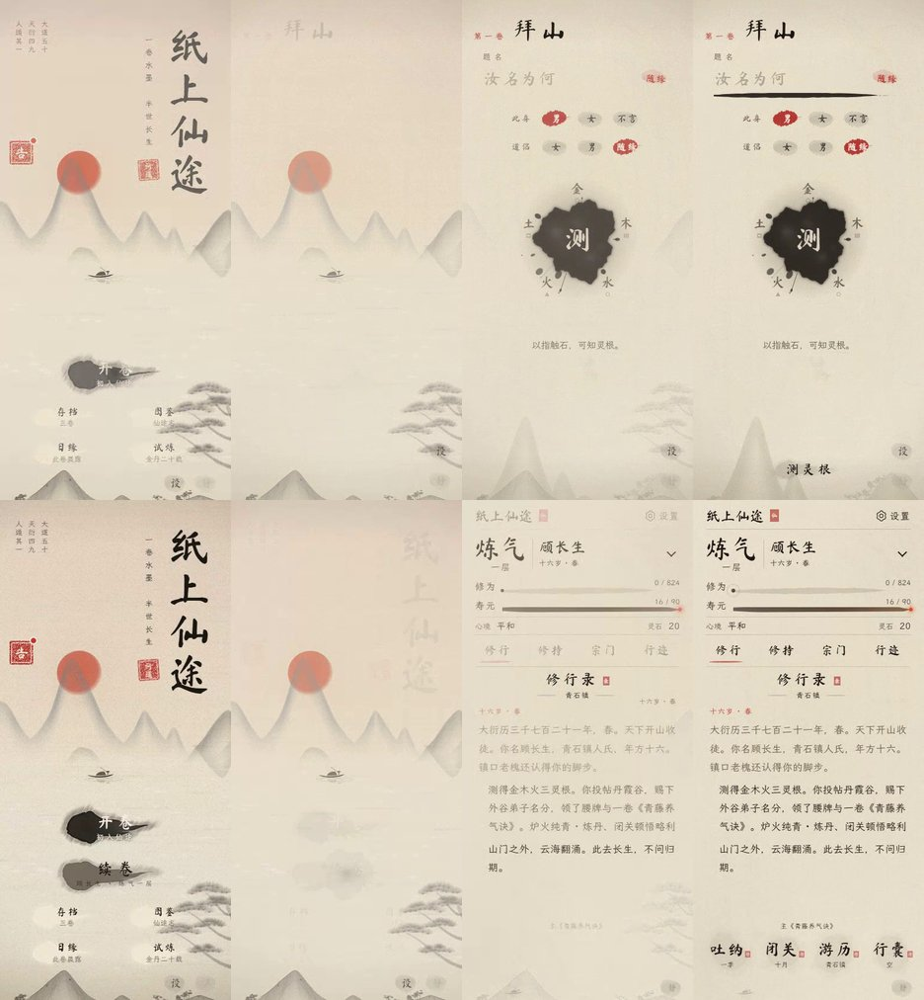
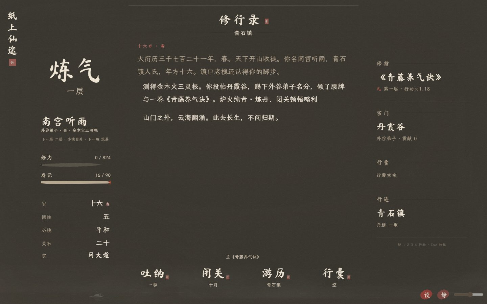
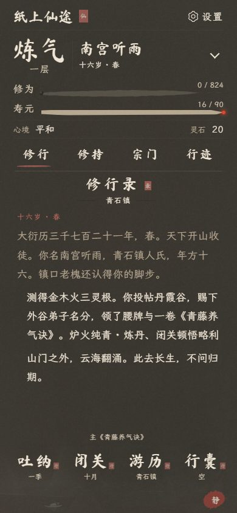

# v100 · 纸中显墨

按用户授权直接替换 v99 的跨屏飞字转场。开卷约 2.6 秒、续卷约 1.9 秒、新局入卷约 2.1 秒。

旧山水从正文附近向外隐入同一张底纸，边缘宽缓、不规则。题头、正文、人物与操作在原位置从浅墨恢复清晰；续卷先显出上次年月和最后一条记录。去掉旧主卷 paperSettle 微翻转，避免正文移动。

沿用原开场、同纸底纹、动态壁纸与输入保护；减少动态时直接到达。保留 Esc、旋转、切后台收束，以及无动画接口、无 CSS 遮罩时的回退。不新增图片、纹理或依赖，存档格式仍为 SAVE_V 16。

## 验证

199 项浏览器检查通过：转场 94、开场 34、动态壁纸 35、手机及布局 36。覆盖 320 / 375 / 390 / 440 / 844 横屏 / 1280 / 1440 / 1920，昼夜两色；逐帧采样姓名、境界、修行录和正文坐标不变，临时日期与图层能清理。

另验证金丹 195 岁测试档、遮罩中心透明/外围保留/宽缓羽化、无遮罩支持回退。语法、存档迁移与编解码、日志、软回归、字体审计（缺字 0）及 diff 检查通过。

手机采用 Chromium 触屏与视口模拟，未验证实体 iOS Safari；后台测试为模拟 visibilitychange。核心文件哈希及原开场代码对比见 protected-files.json。

## 画面

上下两排分别为开卷、续卷。

## 参考

已检查 [Chrome DevRel 的 View Transitions Demos](https://github.com/bramus/view-transitions-demos)。沿用本项目 DOM、Canvas、Web Animations，保证兼容目标；160×100 的短暂透明遮罩只负责退景，不生成新美术纹理。
