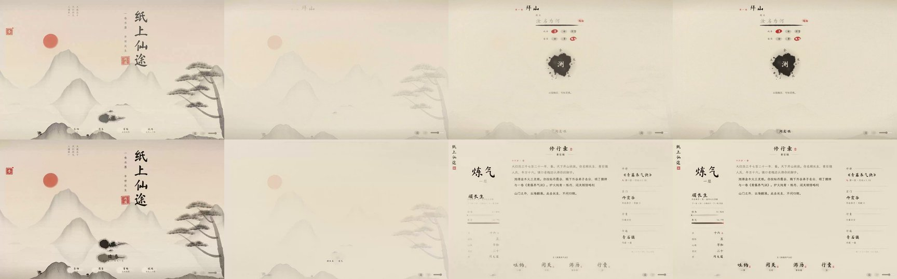
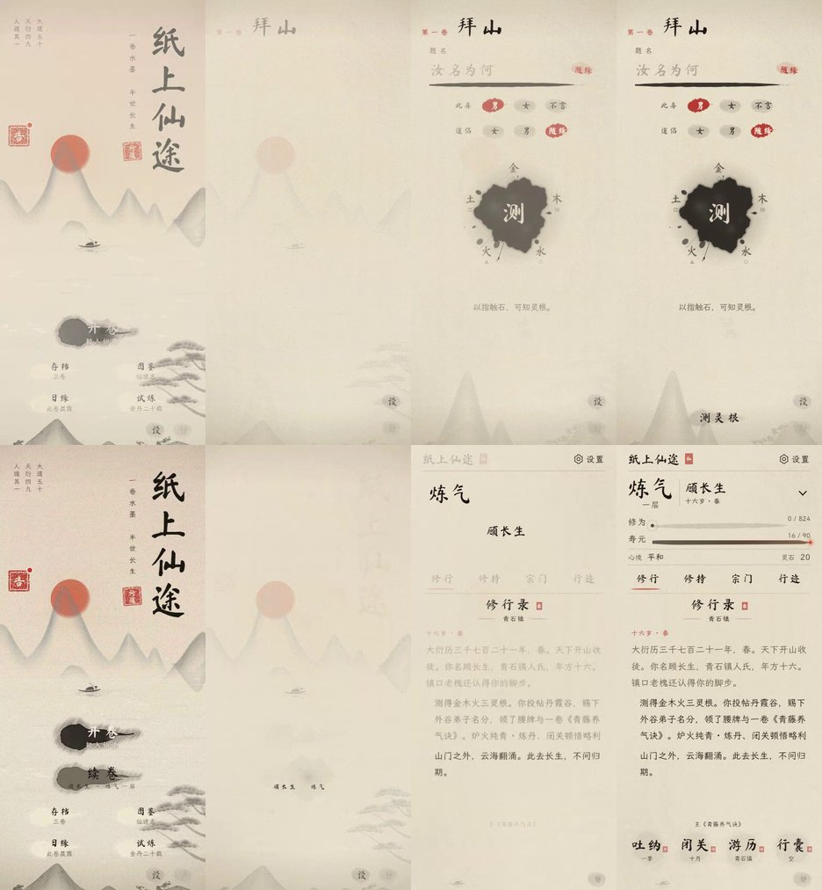
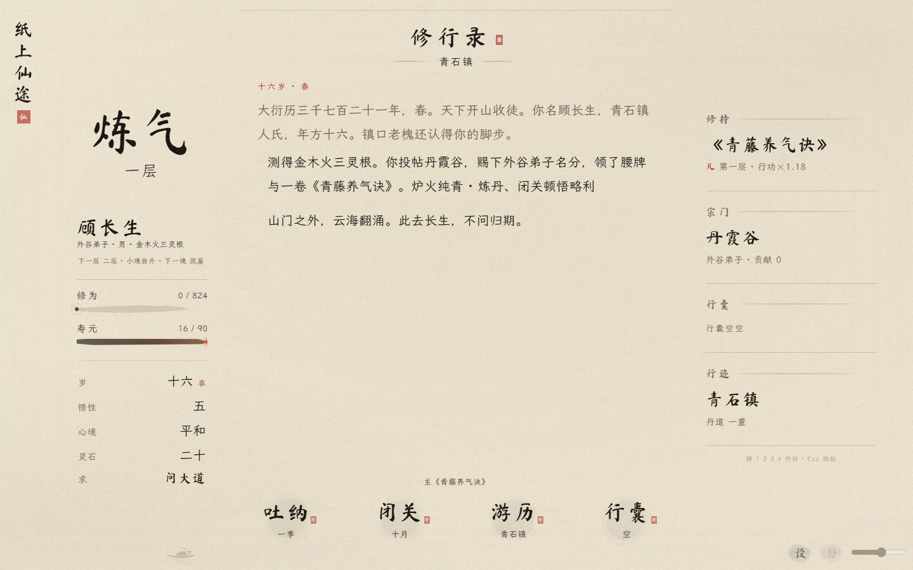
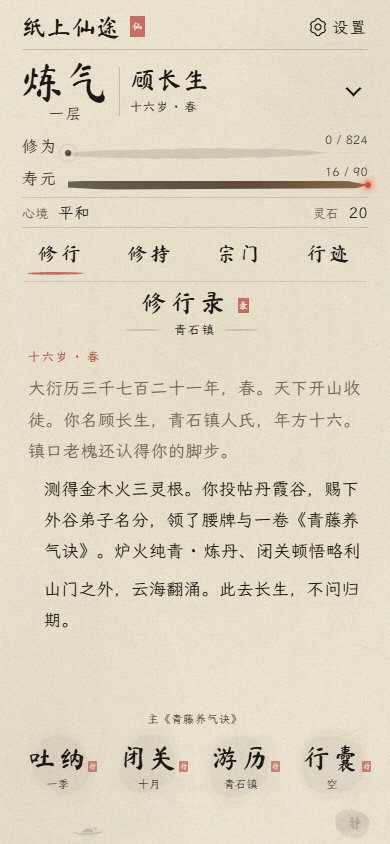
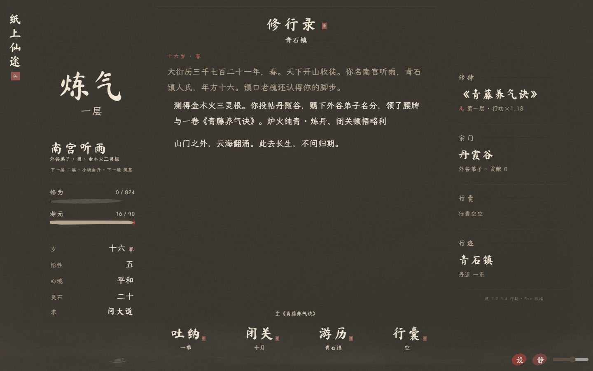
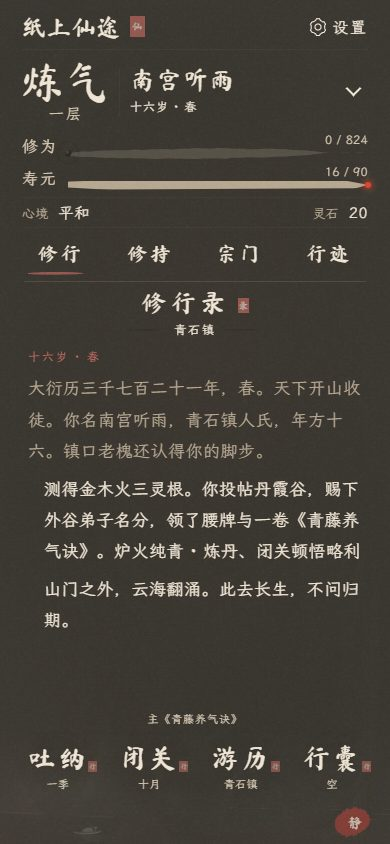

# v99 · 景退成纸，旧墨续写

本次沿用 v98 开场与卷首素材，只改开卷、续卷及创建完成后的衔接。

- 开卷约 2.7 秒：保留点击时的山水，缓缓退淡；题头、题名内容、操作依次显现。
- 续卷约 1.7 秒：姓名与境界从存档摘要归入命籍，最后一条修行记录先显出，属性和操作随后落定。
- 创建完成约 1.9 秒：题名归入命籍，动画结束后再出现此生所求。
- 同一张纸始终保留。手机姓名与境界走不同路径，长姓名换行时柔和交接。
- 减少动态、简动效、动画接口不可用时直接进入；Esc、旋转屏幕、切后台时收束并清理转场。输入在到达前隔离，按住行动键也不会在到达时误操作。

## 开源方案调研

参考 [Chrome DevRel 的 View Transitions Demos](https://github.com/bramus/view-transitions-demos) 的共享元素连续移动思路。为兼容仓库的 Safari 14 / Chrome 80 目标，本次使用现有 DOM、Canvas 与 Web Animations，不引入新依赖，也不要求 View Transition API。

## 验证

199 项浏览器检查通过：转场专项 94 项、原片头 34 项、动态壁纸 35 项、布局与触屏 36 项。另通过语法检查、存档迁移/编解码、日志与软回归、字体审计（缺字 0）及 diff 检查。

专项覆盖 320 / 375 / 390 / 440 / 844 横屏 / 1280 / 1440 / 1920，昼夜两色；逐帧采样姓名与境界不相交、不出屏；验证同纸、无重复 ID、临时层释放、简动效、Esc、旋转、切后台、减少动态、故障回退、弹窗时序与长按保护。

录屏逐帧复核：

手机采用 Chromium 触屏与视口模拟，未在实体 iOS Safari 验证；后台检查为模拟 visibilitychange。

SAVE_V 仍为 16；核心存档、编解码和玩法文件未修改。
