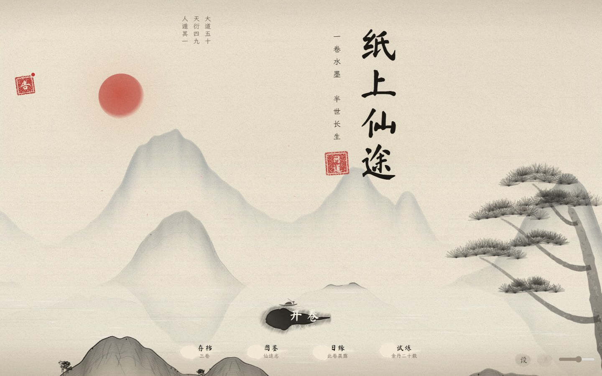
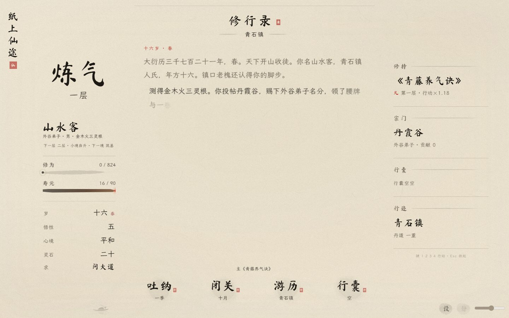

# v95 卷首活墨：菜单与内页对照

2026-10-26。以用户本次明确的主菜单视觉基准替换 v93/v94 的完整山水册表现。GitHub 开源方案检索未找到适合本游戏现有美术的匹配，直接复用仓库已有底纸、墨色、远山画布与笔触。

## 同尺寸桌面对照（1440×900）

菜单：

主界面：

## 六项落实

1. 修行录移除卷轴 WebP 和轴头，改为不占布局高度的 1px 淡墨边；减少原边框内边距，归还正文空间。
2. 取消全幅亭台山石底图与全部段落背景山形。复用既有远山画布，仅在底边低透明度显示；雾也限制在底边。
3. 三栏不再各铺白、黄或灰底，直接共用主菜单同一个纸面 canvas，统一继承墨色变量。夜墨也统一深纸淡墨，补齐原先为暖纸设计的修为条与日志笔触对比度。
4. 去掉枫枝、境界墨圈与行囊按钮墨环，局内飞鹤移除；朱页签视觉缩为 19×21，保留 28×28 点击区域，去掉阴影和边框。
5. 四个行动原字重保持，小印淡朱，不描金不加粗。底边仅保留轻微湖光和小舟；不新增图像或纹理滤镜。
6. 开场逻辑与 HTML 结构未改（仅资源版本由 94 升为 95），核心存档代码未改，SAVE_V 仍为 16。

## 验收

[35 项浏览器检查](checks.json) 全部通过，包括同一个纸面 canvas、无木轴与段落插画、三栏墨色相同、文字几何稳定、动效暂停恢复、手机操作，以及 5 个尺寸昼夜布局和 440×956 DPR3。菜单截图在开场落定后取得，主界面为隔离测试角色。

[受保护文件比对](protected-files.json)：game.js 与 index.html 归一化版本号后与 v94 完全一致；core.js 完全一致。存档、日志、版本一致性、语法和字体审计通过。

[桌面夜墨](main-night.jpg) · [手机日间](main-mobile.jpg) · [手机夜墨](mobile-night.jpg)

环境为 Windows Edge/Chromium，未进行 iOS Safari 真机验收。隐藏事件仍使用模拟 visibilitychange 验证，不等同真机切后台。此次无玩法数值调整。
