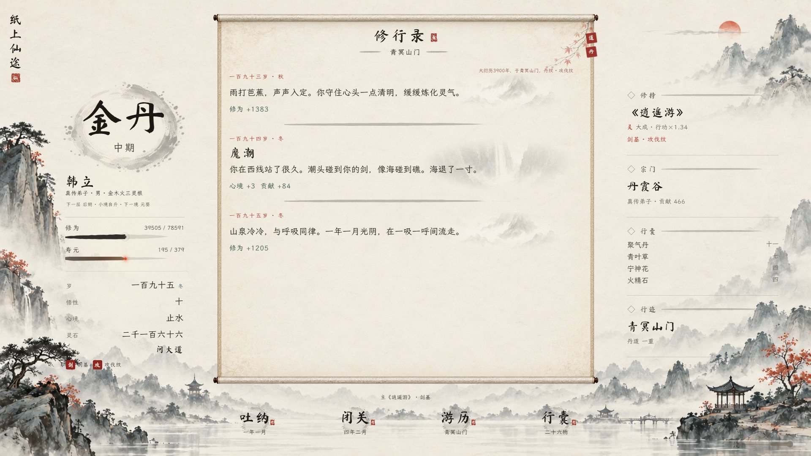
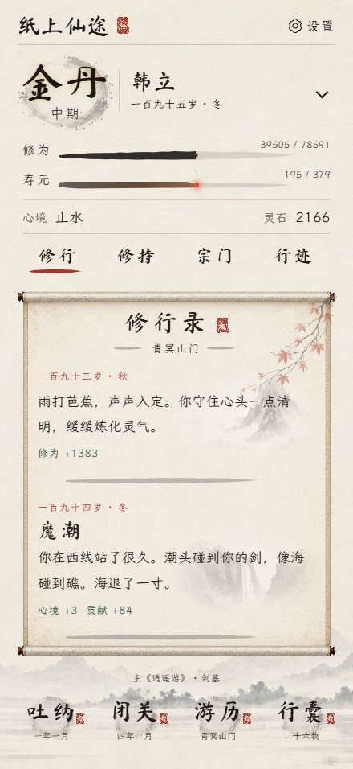

# v93 山水画卷界面验收

2026-10-26。按已确认的桌面、手机画卷概念图落地，沿用静态 HTML/CSS/JS，不引入 UI 框架。开工时检索了 GitHub 上的纸张风格 UI 方案，其组件风格与现有水墨美术不匹配，因此采用现有界面和 Playwright 验证工具。

## 设计与实装

[桌面概念](design-desktop.jpg) · [手机概念](design-mobile.jpg)

[桌面夜间](desktop-night.jpg) · [手机夜间](mobile-night.jpg) · [375 小屏](small-mobile.jpg) · [手机横屏](landscape-mobile.jpg)

- 桌面：全幅山水、墨圈境界、中央修行录画卷、右侧无卡片信息栏、底部四个主要行动。
- 手机：紧凑人物栏、可展开详情、修行/修持/宗门/行迹四页签、底部四个行动。后三页在卷内显示实时摘要，点击进入已有详细面板；行迹页另有因果与印记入口。
- 卷轴采用九宫格边框，保持卷杆和绢边比例；日志滚动时装饰与标题保持稳定。昼夜主题、字号设置、长名字和横屏均有适配。
- 界面展示真实角色数据；概念图里的名字、数值和事件没有硬编码进游戏。截图使用测试角色与日志夹具，方便与设计图比较。
- 本次调整主游戏界面，开场、存档格式与玩法数值保持原有行为。内层功法、宗门等详细面板沿用现有交互。

## 验证

- [交互回归](checks.json)：237/237 通过，无页面异常。覆盖 8 个尺寸的昼夜模式，含 440×956 DPR3；行囊、日志、地图、心愿、论道及新增手机页签、详情和设置入口。
- [最终布局检查](final-geometry.json)：9 个尺寸 × 昼夜，18/18 通过；无页面横向/纵向溢出，日志有可用空间，主要行动位于视口内。尺寸为 1280×720、1366×768、1280×800、1440×900、1920×1080、440×956、390×844、375×812、844×390。
- 最终布局检查发生在最后的装饰遮罩、详情箭头等样式修正之后；237 项交互矩阵先完成，随后没有改变游戏规则。
- JavaScript 语法检查、playtest.js、regress_soft.js（v93）、regress_logs.js、git diff --check 通过。
- 字体审计：MoWen、MoShu、MoCao 缺字与分片重叠均为 0。
- 验证环境为 Windows Edge/Chromium。尺寸模拟不能替代 iOS Safari 真机验证；本次不是自然流程完整人生通关或数值平衡验收。

## 美术与资源

新增 WebP：play-landscape 150,862 字节、play-scroll 235,756 字节、play-ornaments 497,146 字节，共 883,764 字节。正文淡墨图复用原有境界资源。JPEG 验收图均小于 1 MB。

素材由内置 image_gen 工具依据用户已确认的概念图生成，并用 sharp 转为 WebP。按照用户本次许可，生成 PNG 临时落于 C 盘后已迁至 D:/Codex/2026-10-20/https-loser-gif-github-io-xiuxian/outputs/design/v93-assets/，分别为 landscape.png、scroll-frame.png、ornaments.png。仓库保留运行所需压缩资源。

[美术生成说明](art-prompts.md)
